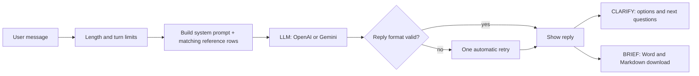

# Problem Framer AI

[](https://www.python.org/)
[](https://streamlit.io/)
[](#configuration)

A Streamlit chat app that interviews you about a vague business problem and turns the conversation into a
structured **Business Requirements Brief**, exportable as Word or Markdown.

<!-- Add your live app link here, for example: **Live demo:** https://your-app.streamlit.app -->
<!-- Add a screenshot:  -->

## Why it exists

Most analytics and operations projects start with a request like "sales are down". Turning that into a
requirement someone can act on means pinning down the decision, the metric, the scope, the data and the
constraints. This app runs that interview for you and keeps the result honest about what you said versus
what the AI assumed.

## Features

- **Guided interview.** Asks up to four questions per turn, with example answers and clickable options when you are unsure.
- **Stated vs Suggested.** Every fact in the brief is tagged as *Stated* (you said it) or *Suggested* (the AI proposed it), and gaps are listed under Open Questions.
- **Reference-grounded.** Matches your wording against curated CSVs of metrics, decisions and diagnostic lenses, and gives the model only the relevant rows.
- **Format checks with one automatic retry.** Every reply is validated against the expected structure; if it fails, the app asks the model to fix only the listed problems once, and warns you if the reply is still off.
- **Exports.** Download the brief as a Word document or as Markdown.
- **Provider-agnostic.** Runs on OpenAI or Google Gemini through LangChain. Switch with one setting.
- **Progress indicator.** Shows the stage of each turn while the model works.
- **Privacy-minded.** Conversations are not stored. Limits: 12 user messages per conversation and 4,000 characters per message.

## How it works



The first line of every model reply is a status tag (`CLARIFY`, `BRIEF` or `CHAT`). The app uses it to decide
what to draw and hides it from the user.

## Quick start

Requires Python 3.11 or 3.12.

```bash
git clone https://github.com/djtongol/problem-framer-ai.git
cd problem-framer-ai
python -m venv .venv
```

Activate the environment: `.venv\Scripts\Activate.ps1` on Windows PowerShell, or `source .venv/bin/activate` on macOS and Linux. Then:

```bash
pip install -r requirements.txt
```

Copy `.streamlit/secrets.toml.example` to `.streamlit/secrets.toml`, fill in your key (see [Configuration](#configuration)), then:

```bash
streamlit run app.py
```

## Configuration

Settings are read from `.streamlit/secrets.toml` locally, or from the Secrets box in your hosting dashboard.
Keys are never typed into the app and never committed.

```toml
PROVIDER = "google"                      # "openai" (default) or "google"
GOOGLE_API_KEY = "your-gemini-key"       # GEMINI_API_KEY is also accepted
OPENAI_API_KEY = "your-openai-key"
MODEL_NAME = "gemini-3.8-flash"          # main model
FAST_MODEL_NAME = "gemini-3.5-flash-lite"
```

| Setting | Required | Notes |
|---|---|---|
| `PROVIDER` | No | `openai` (default) or `google`. |
| `OPENAI_API_KEY` | If using OpenAI | |
| `GOOGLE_API_KEY` | If using Gemini | `GEMINI_API_KEY` works as an alias. |
| `MODEL_NAME` | Recommended | Must match the provider, for example `gpt-...` for OpenAI. |
| `FAST_MODEL_NAME` | Recommended | Lighter model. |

Providers retire models over time, and a retired name fails with a "model not found" error even when the key
is valid. Run `python check_models.py` to list the models your key can use and test the ones in your secrets.

## Tests

```bash
pytest -q
```

Tests use a fake model, so they never call a real API or need a key.

## Project structure

```
app.py                      Streamlit chat page
prompts/system_prompt.md    The full system prompt (edit wording here, not in Python)
data/                       metrics.csv, decisions.csv, diagnostic_lens.csv (reference data)
src/config.py               Settings from secrets, provider choice
src/chain.py                Prompt building, model call, validation, one automatic retry
src/reference_loader.py     CSV loading and keyword retrieval
src/validators.py           Format checks on every reply
src/brief_parser.py         Brief text to Python objects
src/export_docx.py          Word export
src/ui_helpers.py           Colored tags, option buttons, progress, legend
tests/                      pytest tests (fake model, no API calls)
check_models.py             Lists and tests the models your key can use
.streamlit/secrets.toml.example   Template for your secrets
```

## Design decisions

- **Prompt as a file.** The system prompt lives in `prompts/system_prompt.md`, so wording changes need no code change.
- **Validate, then retry once.** LLM output is untrusted. A cheap format check plus a single targeted retry keeps the UI reliable without looping.
- **Retrieval before generation.** Only reference rows that match the conversation are inserted into the prompt, which keeps it focused and short.
- **Safe errors.** Provider exceptions are mapped to short messages that never include keys or raw provider text.
- **Secrets stay out of the repo.** `.gitignore` excludes `.streamlit/secrets.toml`, and the app reads keys only from secrets or environment.

## Limitations

- Experimental tool. Verify all outputs before sharing.
- Output quality and response speed depend on the model you choose. Smaller models are faster but may follow the format less closely.
- Retrieval is keyword-based, so unusual wording may miss relevant reference rows.
- Do not paste confidential or personal data: your text is sent to the AI provider. The app does not store conversations.
- With a shared deployment key, anyone with the link uses that key's quota. Use a dedicated key with a spending limit.
